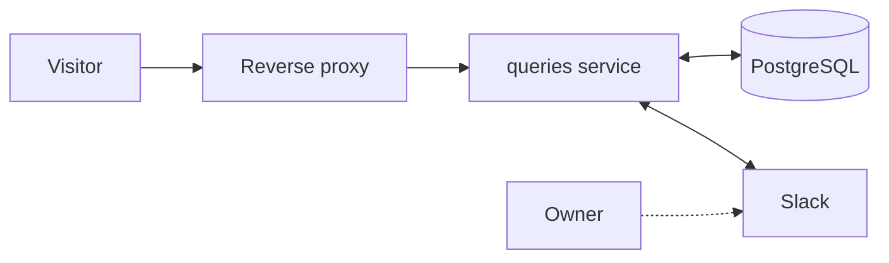
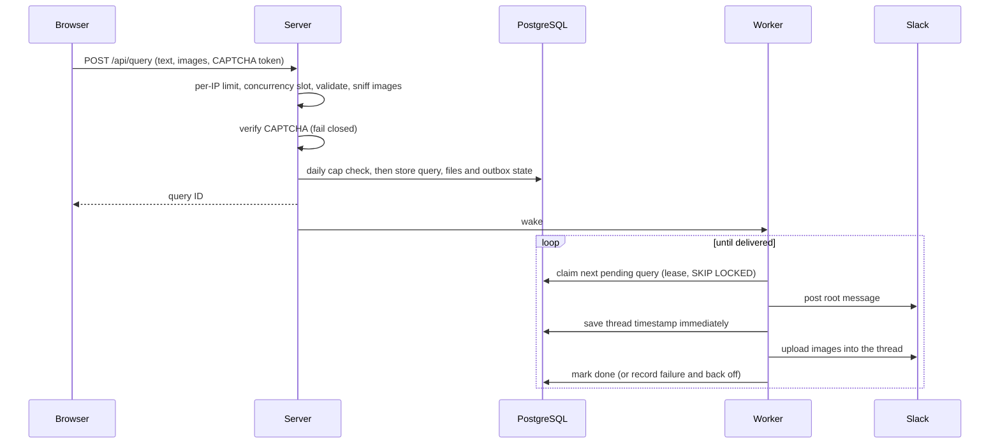
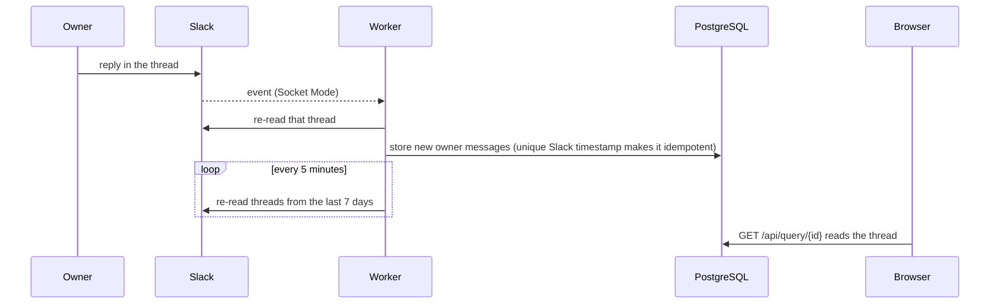
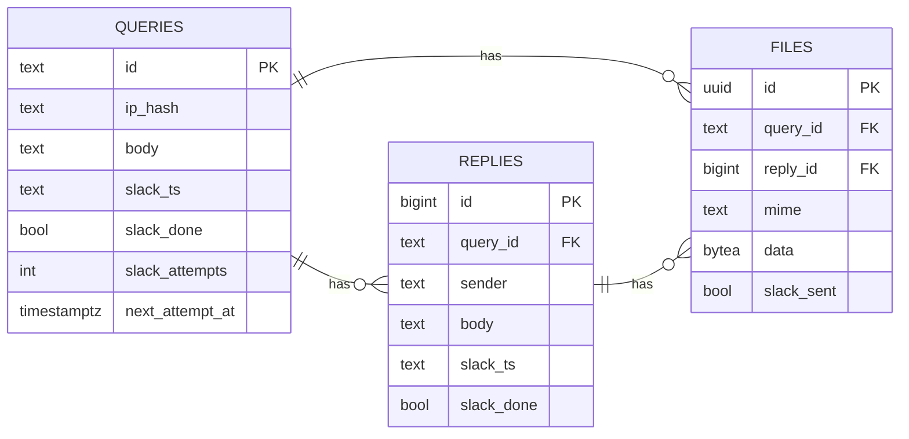

# Architecture

Current state of the `queries` service. Update this file in the same change as any code change that alters components, flows, limits or data (CI checks that every path mentioned here exists).

## Context

Visitors reach the service only through a reverse proxy; the service binds to loopback only. It posts queries to Slack and reads replies back over one outbound WebSocket, so it needs no public callback endpoint. The owner answers from inside Slack.

## Components
| Path | Responsibility |
|---|---|
| `cmd/server/main.go` | Wiring (config, store, Slack clients, worker, HTTP server), graceful shutdown, `healthcheck` subcommand for the container |
| `internal/config/config.go` | Environment variables, limits and defaults; secrets read from `*_FILE` paths |
| `internal/server/server.go` | HTTP routes, multipart parsing and validation, CAPTCHA check, limits, CORS allow-list, request log |
| `internal/server/ratelimit.go` | Per-IP limiter |
| `internal/images/images.go` | Content sniffing, SVG rejection, JPEG metadata stripping |
| `internal/queryid/queryid.go` | Query ID generation and normalisation |
| `internal/captcha/captcha.go` | Server-side CAPTCHA token verification (fails closed) |
| `internal/slackx/slackx.go` | Thin Slack client: post, upload, read thread, download, rate-limit errors, escaping |
| `internal/worker/worker.go` | Outbox delivery to Slack with backoff, and inbound sync (events plus periodic reconcile) |
| `internal/store/store.go` | pgx pool, embedded migrations, all SQL, outbox claiming, follow-up limits |
| `Dockerfile` | Multi-stage build, distroless, non-root |

## Creating a query and delivering it

The answer to the visitor does not wait for Slack, so a Slack outage never loses or blocks a query ([ADR-0002](adr/0002-transactional-outbox-for-slack-delivery.md)).

## Replies coming back

Events only trigger a re-read of that thread; messages not yet stored are added, and only messages from the configured owner are accepted ([ADR-0003](adr/0003-socket-mode-events-with-reconcile.md)).

## Data

Visitor follow-ups share the replies table with the owner's messages (`sender` distinguishes them) and use the same outbox columns. Migrations are embedded in the binary and applied on boot under an advisory lock, so concurrent starts are safe. Images are stored in the database, which keeps backups to a single database dump.

## Limits (defaults in `internal/config/config.go`)
2000-character message, 3 images of at most 5 MiB, a daily cap on new queries, and for follow-ups: 30 per thread, 5 per 10 minutes, a daily cap across all threads. Per-IP limiters guard submit, follow-up and read endpoints, and a semaphore bounds concurrent submissions so memory stays bounded ([ADR-0005](adr/0005-layered-abuse-controls.md)).

## Security and privacy
- Images are validated by content; SVG is rejected; JPEG EXIF/XMP is stripped ([ADR-0004](adr/0004-validate-images-by-content.md)).
- Served files carry `X-Content-Type-Options: nosniff`, a `default-src 'none'; sandbox` CSP and `no-store` caching on API responses.
- The query ID is a bearer capability and is never logged ([ADR-0001](adr/0001-query-id-as-bearer-capability.md)).
- IPs are stored only as an HMAC with a secret salt; message text is rendered with `textContent` on the site.
- Secrets only through files, never plain environment variables or the repository; the container runs as non-root on a distroless image.

## Testing strategy
Slack, CAPTCHA and the store are interfaces; tests use fakes, so `go test -race ./...` needs no network or secrets. Store tests are integration tests against a real PostgreSQL and skip unless `TEST_DB_PORT` is set ([ADR-0006](adr/0006-interfaces-and-real-database-tests.md)).
